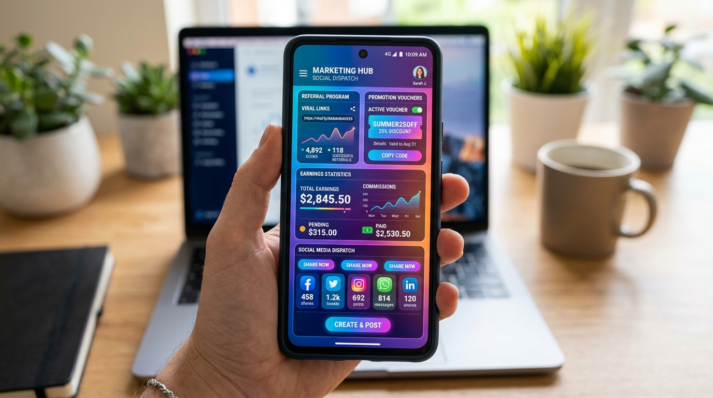

# GlobalMarket Pro 🌐💳

<p align="center">
  
</p>

<p align="center">
  <strong>Next-Generation Global Multi-Currency Sales Terminal & Marketing Growth Platform for Android</strong>
</p>

<p align="center">
  <a href="https://bestpractices.coreinfrastructure.org/"></a>
  <a href="https://github.com/jurgen-paul/GLABA-MARKETING-PRO-APP2/actions"></a>
  <a href="CHANGELOG.md"></a>
  <a href="LICENSE"></a>
  <a href="docs/SECURITY_CRYPTO.md"></a>
  
</p>

---

## 🌐 Project Links & Information
- **Public Source Repository**: [https://github.com/jurgen-paul/GLABA-MARKETING-PRO-APP2.git](https://github.com/jurgen-paul/GLABA-MARKETING-PRO-APP2.git)
- **Official Web Portal**: [https://ais-pre-n5tpggs2goycuuru7okxhe-594875222519.europe-west1.run.app](https://ais-pre-n5tpggs2goycuuru7okxhe-594875222519.europe-west1.run.app)
- **Maintainer**: Jurgen-Paul Westerveld (`westerveldjp@gmail.com`)
- **Google Play Store Listing Guide**: [docs/PLAYSTORE_LISTING.md](docs/PLAYSTORE_LISTING.md)
- **Privacy Policy**: [docs/PRIVACY_POLICY.md](docs/PRIVACY_POLICY.md)
- **FLOSS License**: [MIT License](LICENSE) (Open Source Initiative approved)
- **Release Versioning**: [Semantic Versioning 2.0.0](https://semver.org/spec/v2.0.0.html)

---

## 📖 Overview

**GlobalMarket Pro** is a modern, high-performance, open-source Android application engineered with **Kotlin**, **Jetpack Compose**, and the **Room Database**. It equips international merchants and digital entrepreneurs with an all-in-one terminal to sell worldwide in local currencies, launch high-conversion marketing campaigns with dynamic share links, and track performance with real-time financial analytics.

Designed under the **Clean Minimalism** aesthetic, the app offers high-contrast visual clarity, fluid typography, 16–24dp rounded geometry, and edge-to-edge system insets.

---

## 📱 Google Play Store Showcase Gallery (5 Featured Visuals)

The visual assets below represent the official Play Store feature graphics and high-fidelity promotional content images:

| # | Play Store Feature Asset | Description & Highlights |
|---|---|---|
| **1** |  | **Official Feature Graphic (1024×500)**<br>Next-gen multi-currency POS terminal with holographic rates and global payment simulator branding. |
| **2** |  | **Point-of-Sale (POS) & Dual Checkout**<br>Interactive retail terminal with dual-currency real-time conversion and tap-to-pay checkout modal. |
| **3** |  | **Smart Local Inventory & Stock Tracking**<br>On-device Room database product catalog, SKU tracking, low stock alerts, and quick restock actions. |
| **4** |  | **Growth Marketing & Social Share Hub**<br>Dynamic discount links, partner affiliate commission URLs, QR codes, and native multi-channel dispatch. |
| **5** |  | **Executive Analytics & Sales Dashboard**<br>Real-time revenue charts, regional transaction distribution, conversion rate tracking, and ledger export. |

---

## 🌟 Visual Content Gallery & Key Modules

### 1. 💱 Multi-Currency Payment & POS Terminal
<p align="center">
  
</p>
- Real-time exchange rate engine supporting USD ($), EUR (€), GBP (£), JPY (¥), and CNY (¥).
- Live currency switching with dual-currency transaction preview.
- Interactive credit card checkout modal with formatted inputs, card brand detection, and validation.
- Encrypted local persistence using Android Jetpack Room (`TransactionEntity`, `TransactionDao`).

---

### 2. 📦 Local Inventory Management & Catalog Architecture
<p align="center">
  
</p>
- Dedicated Room database entities (`InventoryProductEntity`, `TerminalTransactionLogEntity`) for enterprise-grade POS inventory.
- Real-time stock decrement upon terminal checkout and automated stock replenishments.
- Product search, category filtering, barcode SKU lookup, and minimum stock threshold indicators.
- Reactive `Flow` data streams via `SalesTerminalDao` ensuring immediate UI synchronization across terminal views.

---

### 3. 📢 Marketing Share Hub & Campaign Growth Links
<p align="center">
  
</p>
- Dynamic campaign presets: **Storefront Checkout** (15% off), **Merchant Partner Referral** (25% commission), and **Flash Promo** (20% limited deal).
- Dynamic campaign URL generation with embedded tracking parameters and promo codes (`GLOBAL15`, `PARTNER25`, `SUMMER2026`).
- Native Android Share Sheet integration (`Intent.ACTION_SEND`).
- Direct 1-tap dispatch to SMS, Email, and Chat channels with pre-filled multi-language copy.
- Clipboard copy with toast feedback.

---

### 4. 📊 Sales Performance & Real-Time Analytics
<p align="center">
  
</p>
- Live distribution charts tracking sales across North America, Europe, Great Britain, and Asia.
- Dynamic conversion rate bars synced with the Room database transaction history.
- Real-time revenue volume calculation in the selected base currency.

---

### 5. 🛡️ OpenSSF Best Practices & Security Shield
<p align="center">
  
</p>
- Complete compliance with Open Source Security Foundation (OpenSSF) criteria.
- Strict Network Security Configuration preventing Man-in-the-Middle (MITM) cleartext attacks.
- Full cryptographic transparency and US Export Control (EAR § 742.15) compliance.

---

## 🏛️ System Architecture

Detailed architecture specifications are available in [docs/ARCHITECTURE.md](docs/ARCHITECTURE.md).

```
com.example
├── data/
│   ├── AppDatabase.kt          # Room Database with SQLite local storage
│   ├── TransactionDao.kt       # DAO interface returning reactive Flows
│   ├── TransactionEntity.kt    # Entity data model
│   └── TransactionRepository.kt# Clean Architecture Repository pattern
├── ui/
│   ├── theme/                  # M3 Typography, Color & Theme
│   │   ├── Color.kt
│   │   ├── Theme.kt
│   │   └── Type.kt
│   └── GlobalMarketViewModel.kt# MVVM ViewModel with StateFlow state streams
└── MainActivity.kt             # Jetpack Compose Edge-to-Edge Single-Activity
```

- **UI Toolkit**: Jetpack Compose with Material Design 3 (M3)
- **Concurrency**: Kotlin Coroutines & `StateFlow` / `collectAsStateWithLifecycle`
- **Data Persistence**: Android Jetpack Room (SQLite)
- **Network Stack**: OkHttp 4 + Retrofit 2 + Moshi (TLS 1.3 enforced)
- **Minimum SDK**: API 24 (Android 7.0) | **Target SDK**: API 36 (Android 16 Ready)

---

## 🔒 Security, Cryptography & Export Controls

Full security documentation is located in [docs/SECURITY_CRYPTO.md](docs/SECURITY_CRYPTO.md) and [SECURITY.md](SECURITY.md).

### Good Cryptographic Practices
- **Transport Security**: TLS 1.3 is enforced for all external network endpoints.
- **Storage Encryption**: Android Keystore AES-256-GCM is used for sensitive credentials.
- **Hashing**: SHA-256 is used for checksum and signature verification.
- **Zero Insecure Ciphers**: No legacy ciphers (MD5, DES, RC4) are permitted.

### US Export Controls & EAR Compliance
*Note on Encryption Software Export*:
- In accordance with U.S. Export Administration Regulations (EAR, 15 C.F.R. § 742.15(b)), GlobalMarket Pro makes its source code publicly available without restrictions under the [MIT License](LICENSE) at [https://github.com/jurgen-paul/GLABA-MARKETING-PRO-APP2.git](https://github.com/jurgen-paul/GLABA-MARKETING-PRO-APP2.git).
- The cryptographic features utilized are standard platform libraries (Android Conscrypt/BoringSSL) rather than custom engines.
- Appropriate export notification has been registered in compliance with EAR requirements.

### Secured Against Man-in-the-Middle (MITM) Attacks
- Enforced via `app/src/main/res/xml/network_security_config.xml`:
  ```xml
  <network-security-config>
      <base-config cleartextTrafficPermitted="false">
          <trust-anchors>
              <certificates src="system" />
          </trust-anchors>
      </base-config>
  </network-security-config>
  ```
- Cleartext HTTP traffic is blocked at the system socket layer.
- Release binaries are protected with APK Signature Scheme v2 and v3.

### Vulnerability Reporting Process
Security issues should be reported privately to **`westerveldjp@gmail.com`** or via [GitHub Security Advisories](https://github.com/jurgen-paul/GLABA-MARKETING-PRO-APP2/security/advisories). Review our [SECURITY.md](SECURITY.md) for full SLA details (48h acknowledgment).

---

## 🧪 Automated Testing & Code Quality

Full testing guide is in [docs/TESTING.md](docs/TESTING.md).

### 1. Automated Test Suite (Local JVM)
```bash
# Run the complete Robolectric test suite
gradle :app:testDebugUnitTest
```
- **Robolectric Local Tests**: `app/src/test/java/com/example/ExampleRobolectricTest.kt` verifies:
  - Room DAO transactions (insert, query, clear).
  - Marketing Campaign Link generation and promo code parsing.
  - Multi-language dictionary resolution for 5 supported languages.
  - Profile state updates and security toggle persistence.

### 2. Screenshot & Visual Regression Testing
```bash
# Verify UI with Roborazzi
gradle :app:verifyRoborazziDebug
```

### 3. Policy for Testing New Functionality
- Every new feature must be covered by automated tests before merging.
- Uncovered pull requests will be rejected by CI.

### 4. Static Code Analysis & Compiler Warnings
- **Android Lint**: Run `gradle :app:lintDebug` to check for syntax, layout, performance, and accessibility issues.
- **Strict Kotlin Compiler Flags**: Null-safety, exhaustive pattern matching, and deprecation checks.

### 5. Dynamic Code Analysis
- **Android StrictMode**: Configured to flag disk I/O or network leaks on the main thread.
- **Lifecycle Collection**: Uses `collectAsStateWithLifecycle()` to prevent memory leaks during configuration changes.

---

## 🚀 Getting Started & Build Instructions

### Prerequisites
- **Android Studio** (Ladybug 2024.2.1 or newer)
- **JDK 17**
- **Android SDK Platform 36**

### Build the Application
```bash
# 1. Clone the repository
git clone https://github.com/jurgen-paul/GLABA-MARKETING-PRO-APP2.git
cd GLABA-MARKETING-PRO-APP2

# 2. Build Debug APK
gradle :app:assembleDebug

# 3. Run Automated Tests
gradle :app:testDebugUnitTest
```

---

## 📋 Release Notes & Changelog
- [CHANGELOG.md](CHANGELOG.md) — Comprehensive version history following Keep a Changelog.
- [RELEASE_NOTES.md](RELEASE_NOTES.md) — Highlights of the latest v2.0.0 release.

---

## 🤝 Contributing & Bug Reporting
- [CONTRIBUTING.md](CONTRIBUTING.md) — Development setup, pull request process, and coding standards.
- [Bug Report Template](.github/ISSUE_TEMPLATE/bug_report.md) — Standardized template for non-security bug reports.
- [Feature Request Template](.github/ISSUE_TEMPLATE/feature_request.md) — Suggest ideas and enhancements.

---

## 📄 License
This project is licensed under the **MIT License** — see the [LICENSE](LICENSE) file for details.
